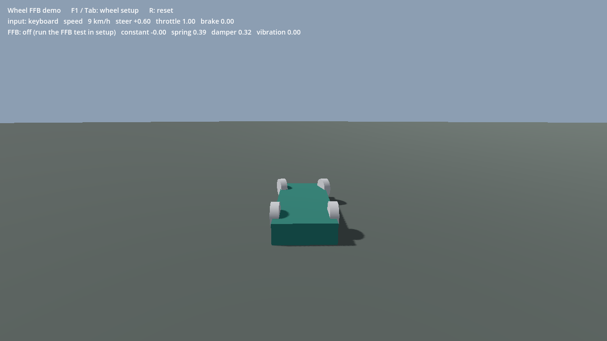
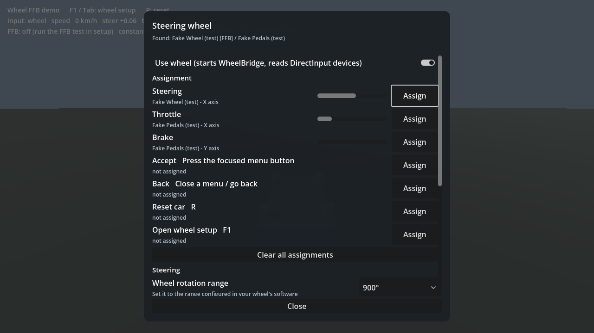

# Wheel FFB for Godot

Steering wheel + pedals **input and force feedback** for Godot 4 on Windows.

Godot reads wheels as generic gamepads (through SDL) and has no force feedback for them. This addon adds a small
DirectInput bridge (`WheelBridge.exe`, C++, source included) that the game launches in the background and talks to
over localhost UDP. You get:

- **Separate devices** — wheel base and pedals from different makers (e.g. Simagic + Heusinkveld) are bound per
  *device + axis*, so they work together.
- **Assignment by doing it** — press "Assign" and turn the wheel / press the pedal / press a button. Inverted
  pedal axes and load-cell brakes are calibrated automatically.
- **Force feedback** — constant force, spring, damper, friction and vibration, sent every physics frame. Includes a
  ready-made helper for Godot's `VehicleBody3D` (self-aligning torque that goes light past the grip limit).
- **Safety for direct-drive wheels** — low default strength, FFB stays off until the user confirms the force
  direction with a guided test, forces ramp up over 1 s, are slew-limited and fade to zero if the game stops
  updating them (pause, scene change, crash).
- **Menu navigation** with the wheel's hat switch, and wheel buttons that fire your InputMap actions.
- **A setup screen** (`WheelSetupPanel`) built from plain Godot controls, so it follows your theme.
- **Tests without hardware** — the bridge can emulate a wheel and pedals (`--wheel-fake`).

| Demo | Setup screen |
|---|---|
|  |  |

> **Status: early (0.1.0).** Input and FFB have been verified on a Simagic Alpha Series wheelbase (Alpha U) and
> Heusinkveld Sim Pedals Sprint. Other DirectInput wheels should work but have not been tested yet — reports welcome.
> Windows only (DirectInput). Tested with Godot 4.7.2.

## Install

1. Copy `addons/wheel_ffb` into your project.
2. Project → Project Settings → Plugins → enable **Wheel FFB**. This registers the `WheelInput` autoload.

`addons/wheel_ffb/bin/WheelBridge.exe` is prebuilt. To build it yourself: run `addons/wheel_ffb/bridge/build.bat`
(MSVC C++ build tools + Windows SDK, no other dependencies).

## Use it in your game

```gdscript
func _physics_process(delta: float) -> void:
	var steer: float      # -1..1, right positive
	var throttle: float
	var brake: float
	if WheelInput.steer_active():
		steer = WheelInput.steer_value()            # apply 1:1 - no smoothing / rate limit for a real wheel
	else:
		steer = Input.get_axis("steer_left", "steer_right")
	if WheelInput.has_pedals():
		throttle = WheelInput.pedal_value("throttle")
		brake = WheelInput.pedal_value("brake")
	else:
		throttle = Input.get_action_strength("accelerate")
		brake = Input.get_action_strength("brake")
	# ... drive your car ...

	# Force feedback for a VehicleBody3D:
	ffb.update(car, delta)    # var ffb := WheelFFBVehicle.new()
	ffb.send()
```

Open the setup screen from your options menu:

```gdscript
var panel := WheelSetupPanel.new()
add_child(panel)
panel.open()
panel.closed.connect(panel.queue_free)
```

Let wheel buttons trigger your actions (they appear in the setup screen):

```gdscript
WheelInput.register_action("shift_up", "Shift up", "Right paddle")
WheelInput.register_action("pause", "Pause")
```

Bound buttons are sent as `InputEventAction`s, so your existing `_unhandled_input` code keeps working. The hat
switch sends `ui_up` / `ui_down` / `ui_left` / `ui_right` (with key repeat), so Godot's focus navigation works
with the wheel.

### Custom physics

If you have your own tyre model, send the real forces instead of using `WheelFFBVehicle`:

```gdscript
# constant -1..1, RIGHT positive: the aligning torque pulls the rim back to centre (negative while turning right).
# A good source: sum over the steered tyres of lateral_force * pneumatic_trail(slip_angle), divided by the
# front axle load. The trail shrinks as the slip angle grows, so the wheel goes light at the grip limit.
WheelInput.send_ffb(constant, spring, damper, friction, vibration, vibration_ms)
```

`ffb_gain` (strength), `ffb_invert` (direction) and the user's damper / spring / vibration multipliers are applied
inside `send_ffb`. Nothing is sent until the user has confirmed the direction with the FFB test.

## API (autoload `WheelInput`)

| Member | |
|---|---|
| `steer_active()` / `has_pedals()` | a wheel / pedals are bound and reporting |
| `steer_value()` | -1..1, right positive. Wheel rotation range (`wheel_range`) mapped to the car's `lock_to_lock` |
| `pedal_value("throttle" \| "brake")` | 0..1 |
| `button_down(action)` | a bound button is held |
| `register_action(action, label, hint)` | let a wheel button trigger an InputMap action |
| `send_ffb(constant, spring, damper, friction, vibration, vibration_ms)` | this frame's force feedback |
| `ffb_block_reason()` | why FFB cannot run right now (`""` = ready) |
| `devices`, `connected`, `link_problem` | state for your own UI |
| signals `devices_changed`, `capture_finished`, `ffb_test_changed` | |

Settings are saved to `user://wheel_ffb.cfg` (`--wheel-config=PATH` to override).

## Shipping an exported game

The bridge must be a real file next to your game: copy `addons/wheel_ffb/bin/WheelBridge.exe` into the export
folder, next to your `.exe`. (A file inside the `.pck` cannot be launched.)

## Tests (no hardware needed)

```bash
godot --headless --path . res://tests/wheel_test.tscn -- --wheel-fake      # all: vehicle, link, capture, pov, panel, revive
godot --headless --path . res://tests/wheel_test.tscn -- --test=real       # real devices: list them (no FFB)
```

The virtual devices use their own UDP port (49351), so tests never talk to a running game's bridge (49321).
Do not add `--fixed-fps`: the bridge runs in real time.

## Bridge tool

```bash
addons/wheel_ffb/bin/WheelBridge.exe --list          # devices, axes, FFB support
addons/wheel_ffb/bin/WheelBridge.exe --monitor 20    # raw axis / button values for 20 s
addons/wheel_ffb/bin/WheelBridge.exe --ffbtest 0     # gentle FFB self-test on device #0 (capped at 15 %)
```

## Troubleshooting

- **"Found" shows the pedals but not the wheel / FFB says "busy"**: another program holds the wheel exclusively
  (another game, or a second copy of your game). Close it, then switch "Use wheel" off and on.
- **The brake cannot be assigned / brakes too hard**: load-cell brakes report force, not travel. Assign it pressing
  as hard as you brake when driving — that force becomes 100 %.
- **Force feedback pulls the wrong way**: run the FFB test again (it sets the direction), or toggle "Invert".
- Log: `user://wheel_bridge.log`.

## How it works

```
wheel base ─┐                                  ┌ Godot (autoload WheelInput)
            ├ DirectInput ─ WheelBridge.exe ─ UDP ┤  bindings, calibration, buttons → InputMap actions,
pedals ─────┘ (input + FFB)  127.0.0.1:49321   └  FFB from your game, setup screen
```

The bridge reads every DirectInput game controller at ~500 Hz, sends state as JSON at ~200 Hz, and plays the
effects (DirectInput constant force / spring / damper / friction / sine) on the device bound to steering, with
writes capped at 250 Hz. The game launches it with its own process id and the bridge exits when the game does.

## Credits / license

MIT License (see `LICENSE`). Extracted from "Sonnet Drive", a GT7-inspired
Godot driving game where it was first built and tested on real hardware.

---

## 日本語

Godot 4（Windows）向けの、ハンコンとペダルの**入力とフォースフィードバック**のアドオンです。Godot はハンコンを
ゲームパッドとして読むだけで、FFB には対応していません。このアドオンは DirectInput の小さなブリッジ
（`WheelBridge.exe`、C++、ソース同梱）をゲームから裏で起動し、localhost の UDP でやり取りします。

- 本体とペダルが別メーカーでも（例: Simagic + Heusinkveld）、「デバイス + 軸」で割り当てるので一緒に使える
- 「割り当て」を押してホイールを回す / ペダルを踏む / ボタンを押すだけ。逆向きの軸やロードセルのブレーキも自動で調整
- FFB: 定常力・スプリング・ダンパー・フリクション・振動。`VehicleBody3D` 用の補助クラス付き（限界を超えると軽くなる自己整列トルク）
- ダイレクトドライブ向けの安全策: 既定の強さは控えめ、力の向きをテストで確認するまで FFB は ON にならない、
  1 秒かけて立ち上げ、急な変化を制限、ゲームからの更新が途絶えたら自動で 0
- ハンコンの十字キーでメニュー操作、ボタンをゲームの InputMap のアクションに割り当て
- 設定画面（`WheelSetupPanel`）付き。実機なしで試せる仮想デバイス（`--wheel-fake`）とテスト付き

確認済みの実機は Simagic Alpha シリーズのベース（Alpha U）と Heusinkveld Sim Pedals Sprint だけです。
ほかのハンコンでの動作報告を歓迎します。使い方は上の英語の節を見てください。
